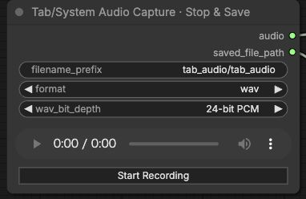
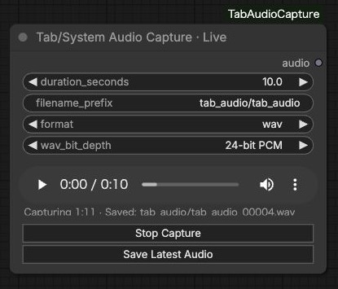
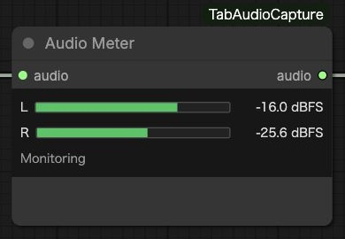
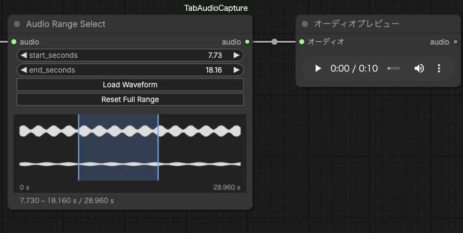

# ComfyUI-TabAudioCapture

Capture playback audio from a Chrome/Chromium tab or the entire PC and output standard ComfyUI `AUDIO`. Tab capture also includes cross-origin iframes without accessing their DOM.

## Tab/System Audio Capture

This is the main recording node. It records playback audio from a Chrome tab or the entire PC, then saves the recording when you stop.



- Set the save options before `Start Recording`, then share tab or system audio. `Stop & Save` saves the recording and updates the native audio player without running the workflow.
- `Pause Recording` / `Resume Recording` keeps the same sharing session and joins only the recorded portions. You can use `Stop & Save` while paused. The timer and 10-minute limit count recorded audio, excluding pauses.
- `filename_prefix` selects a folder and filename inside `ComfyUI/output`. For example, `music/take` creates `output/music/take_00001.wav`. The default remains `tab_audio/tab_audio`.
- `format`: `original` preserves captured float32 PCM in WAV; `wav` writes 16/24/32-bit PCM (default: 24-bit); `m4a` writes AAC at 128/192/256/320 kbps (default: 256 kbps). The relevant depth or bitrate control appears under Advanced for the selected format.
- `Run` outputs `audio` (`AUDIO`) and `saved_file_path` (`STRING`). The path is absolute and connects directly to Video Helper Suite's **Load Audio (Path)** → `audio_file` input.
- Saved file references remain in workflows and work after restarting ComfyUI. Recordings stop after 10 minutes and preserve the AudioContext sample rate. Saved recordings are not automatically deleted.

## Select the audio source

In **Tab/System Audio Capture**, click `Start Recording`, then choose what to record in Chrome's sharing dialog:

| Audio you want to record | Select in Chrome | Enable |
| --- | --- | --- |
| Playback from one tab, including embedded audio | **Chrome Tab**, then the source tab | **Share tab audio** |
| Playback from all applications on the PC | **Entire Screen**, then the screen | **Share system audio** |

The source tab can be the ComfyUI tab or another tab. Entire-PC recording includes other applications and notification sounds, and requires browser/OS support for system audio sharing. Screen/audio recording permission may be required.

Only audio is sent to ComfyUI and saved. Enable audio sharing each time you start; selecting a screen alone does not provide audio. The captured audio is playback audio rather than microphone input.

## Tab/System Audio Capture · Live (optional)

Use this node when you need the latest N seconds at queue time. It supports the tab and entire-PC audio sources described above.



- Click `Start Capture` and share tab or system audio. Capture continues independently of workflow execution and retains the latest 120 seconds.
- Set `duration_seconds` (0.5–60 seconds), then click `Run`. The node snapshots the latest audio when you queue the workflow, so waiting for GPU execution does not change that snapshot.
- `Save Latest Audio` freezes that many seconds and saves them without stopping capture or running the workflow. It uses the same filename prefix, Original/WAV/M4A formats, depth and bitrate settings as the recorder. The default is 24-bit WAV. You can save repeatedly, including after capture has stopped; each save gets a new numbered filename.
- The native audio player supports playback and seeking after a snapshot or stop. The last captured buffer remains available after `Stop Capture`.
- Output: `audio` (`AUDIO`). The node does not automatically queue or repeat workflows.

## Audio Meter



Connect Recorder or Live → **Audio Meter** using `AUDIO`. It displays left/right peak levels in dBFS while capture is running, without queueing the workflow. Mono capture is shown on both channels. Both channels below −60 dBFS for two seconds display `Silence`; disconnected or inactive captures display a waiting state.

The meter uses its own browser analysis branch and keeps working while the recorder is paused. Removing it does not stop capture. Its `audio` output passes the input through unchanged. Place it directly after Recorder/Live (or through a Reroute or another Meter); after an audio transform it cannot monitor that transform's output in real time.

## Audio Range Select



Connect any standard `AUDIO` → **Audio Range Select** → your downstream audio node.

1. Click `Load Waveform` to execute only through this node and display the full source waveform.
2. Drag across the waveform to select a range, drag either edge to adjust it, or enter `start_seconds` / `end_seconds`. End `0` means the source end; `Reset Full Range` restores the full audio.
3. Run the workflow. The `audio` output contains only that range, with the original sample rate, channels and batches. No audio file is created or modified.

The waveform displays the first batch; the same time range applies to every batch. Bounds are measured from the start of the current input. For a stable selection from Live, use `Stop Capture` before loading the waveform; continuing capture supplies a new snapshot on each Run. The recorder's `saved_file_path` continues to refer to its complete saved recording.

## Additional capture and analysis nodes (feature branch)

### Smart Audio Capture

Smart Audio Capture records tab or system playback into individual takes based on the incoming sound level. Click **Start Smart Capture**, select a Chrome tab with **Share tab audio** (or a supported system-audio source), and play audio. The node begins a take after the input remains above `threshold_db` for `min_sound_seconds`. It includes up to `pre_roll_seconds` of buffered audio before the trigger, stops and saves each take after `silence_seconds` of silence, and then waits for the next take.

- Saved takes appear in a selector and remain on disk under `ComfyUI/output` (WAV 24-bit PCM).
- The most recently saved take is selected automatically; selecting an older take changes the `AUDIO` and `saved_file_path` outputs for the next workflow execution.
- History holds the latest 30 filenames in the workflow; older recordings are **not** deleted.
- A take is capped at approximately 60 seconds. The detector uses RMS averaged over short PCM chunks, not semantic music or speech detection.
- Like the other capture nodes, this feature requires a browser permission prompt and a local HTTPS/localhost ComfyUI instance.

### Audio Loop Capture

Connect any `AUDIO` input, including **Tab/System Audio Capture · Live**, to **Audio Loop Capture**. Set BPM, `bars`, and `beats_per_bar` to select a fixed-duration loop ending at the latest available sample (or earlier using `end_offset_seconds`). The output is regular `AUDIO` plus the loop duration in seconds.

An optional short `crossfade_ms` blends the end toward the loop beginning, but this is not an automatic beat detector, downbeat-aligner, or time-stretcher. The input must be long enough to contain the requested bars. The upstream Live node's snapshot window must cover the full loop.

### Audio Feature Extractor

Connect any standard `AUDIO` and choose the feature sampling `fps`, bass cutoff, and treble start frequency. Output:

- `features_json`: per-batch arrays of time-stamped `rms` (linear amplitude), `bass` and `treble` (relative spectral-energy amplitudes), and `onset` (positive spectral flux normalized to 0–1).
- Summary FLOAT outputs: `mean_rms`, `mean_bass`, `mean_treble`, `max_onset`.

Features are calculated from a fixed audio snapshot, **not** continuously pushed downstream while a workflow executes. FFT features represent coarse analysis, not source separation or BPM estimation. Supply frame-wise JSON to downstream custom nodes, or use summary outputs directly.

## Example workflows

Drag a JSON file into ComfyUI. Choose the audio source when starting capture.

- [Record, save and inspect outputs](example/record_tab_audio.json): recorder → Preview Audio and saved path display.
- [Load the saved path](example/record_tab_audio_with_vhs.json): `saved_file_path` → Load Audio (Path) → Preview Audio. Requires Video Helper Suite.
- [Snapshot the latest audio](example/live_tab_audio.json): Live → Preview Audio.
- [Monitor and select a range](example/select_audio_range.json): recorder → Audio Meter → Audio Range Select → Preview Audio.

The existing node IDs (`TabAudioCaptureLive`, `TabAudioCaptureRecorder`) and example filenames are unchanged so existing workflows remain compatible.

## Installation

1. Place this repository in `ComfyUI/custom_nodes/ComfyUI-TabAudioCapture`.
2. Restart ComfyUI and reload the browser.
3. Search for `Tab/System Audio Capture`, add the main recording node, and connect its `audio` output to an audio input. Use the optional `Live` node for rolling snapshots.
4. Start capture and share tab or system audio as described above.

Runtime dependencies are listed in `requirements.txt`: `torch`, `numpy`, `aiohttp` and `av`. All four are already required by ComfyUI, with the same version constraints. This node adds no other runtime packages. If any are missing, install them using ComfyUI's Python environment:

```bash
python -m pip install -r requirements.txt
```

## Notes

- Chrome/Chromium is the intended browser. Audio capture requires HTTPS or a localhost connection. Browser and OS support determines whether entire-PC audio is available.
- Tab capture mixes all playback within the selected tab; it cannot isolate one iframe. Protected playback or source restrictions may prevent capture.
- Audio passes through AudioWorklet → float32 PCM → WebSocket → ComfyUI. The native `AUDIO` value contains `waveform` shaped `[1, channels, samples]` and `sample_rate`.
- `AUDIO` sockets carry fixed snapshots or completed recordings, not a continuous stream that updates an already-running generation.
- Live snapshots use temporary disk files and do not survive a server restart. Snapshots older than 24 hours are cleaned up when starting a new session.
- Capture stops if pending WebSocket data exceeds 4 MiB. Network interruptions or closing the browser tab may interrupt recording. HTTPS reverse proxies must support WebSocket upgrades.
- Intended for a local ComfyUI installation and browser. Environments that restrict custom nodes may not support these nodes.

## License

[MIT](LICENSE).
